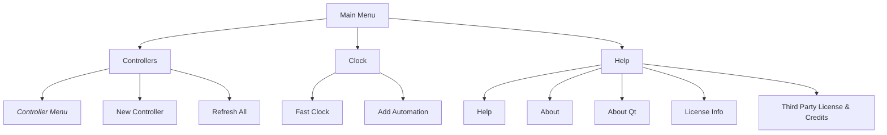
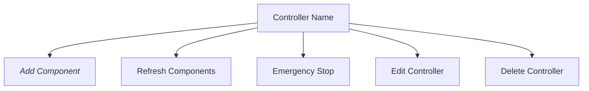
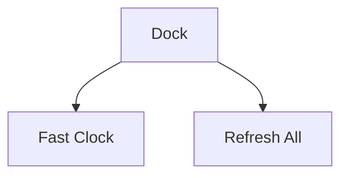

## Overview
This outlines the structure of the Main App Menu. This is only implemented on platforms that have a native menu bar: Mac OS and some Linux desktop experiences. Implementation details can be found here in [[Native App Menu Bar]].

## Main Menu Structure

## Controller Menu
One controller sub-menu is added to the controller menu for each controller configured. An "Add Component" menu item is added for each component capability the controller has

## Dock Menu

